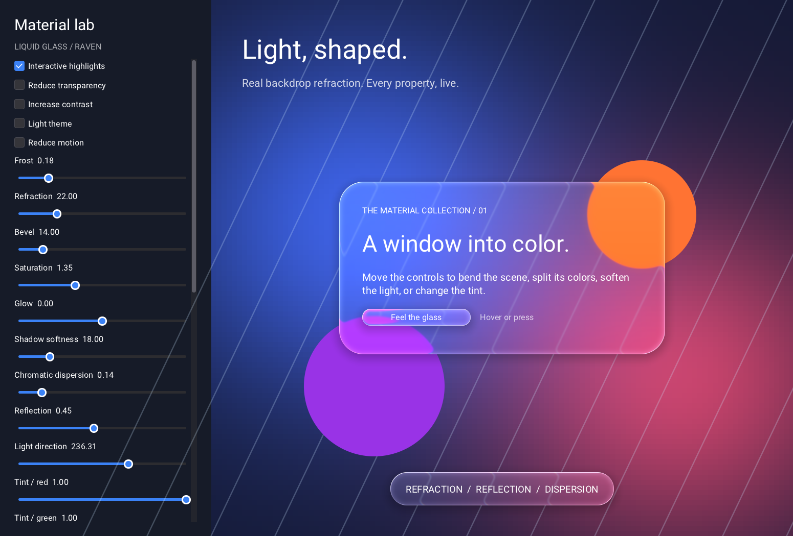

# Liquid glass surfaces

Select `R_MATERIAL_LIQUID_GLASS` on any surface, or select it for the theme
with `Rtheme_set_material`. Existing material values and looks are unchanged.
The reference Vulkan backend renders the effect on Windows, Linux, and macOS.
It samples content already drawn in the same Raven window. This is Raven's
configurable liquid glass material, not Apple's private native material API.

```c
RLiquidGlass glass;
Rliquid_glass_defaults(&glass);
glass.refraction = 32;
glass.dispersion = 0.3f;
Rwidget_set_material(panel, R_MATERIAL_LIQUID_GLASS);
Rwidget_set_liquid_glass(panel, &glass);
```

`Rwidget_get_liquid_glass` copies the current override or defaults.
`Rwidget_set_liquid_glass(panel, NULL)` clears the override. The setter copies
its input; it does not select a material. Properties belong to the widget,
not its children. Initialize the whole structure with the defaults function.
The ordinary material/theme/style selection still determines which material
is drawn. Liquid glass properties override the five legacy glass metrics.

| Property | Range / meaning | XML attribute |
| --- | --- | --- |
| `frost` | 0 sharp to 1 fully frosted; mixes sharp and dual-filtered backdrop | `LiquidGlass.Frost` |
| `refraction` | 0..96 logical pixels of displacement at the curved edge | `LiquidGlass.Refraction` |
| `bevel` | 0 automatic, otherwise 0..96 logical pixels of curved edge | `LiquidGlass.Bevel` |
| `saturation` | 0 grayscale, 1 unchanged, up to 4 | `LiquidGlass.Saturation` |
| `glow` | -1..1 added brightness | `LiquidGlass.Glow` |
| `shadow` | 0..96 logical pixels of shadow softness | `LiquidGlass.Shadow` |
| `dispersion` | 0..1 chromatic separation | `LiquidGlass.Dispersion` |
| `reflection` | 0..1 environment reflection strength | `LiquidGlass.Reflection` |
| `light_angle` | 0..360 degrees; 0 points right, 90 points down | `LiquidGlass.LightAngle` |
| `tint[4]` | RGBA overlay, each channel 0..1 | `LiquidGlass.Tint` |
| `rim[4]` | RGBA rim light, alpha controls intensity | `LiquidGlass.Rim` |
| `shadow_color[4]` | RGBA shadow | `LiquidGlass.ShadowColor` |
| `interactive` | Adds feedback from a control's hover and pressed states | `LiquidGlass.Interactive` |
| `reduced_transparency` | Opaque theme panel, without backdrop work | `LiquidGlass.ReducedTransparency` |
| `high_contrast` | Opaque theme panel with a 2px text-color outline | `LiquidGlass.HighContrast` |

Colors in XML accept Raven's usual `#RRGGBB` / `#RRGGBBAA` syntax. Finite numeric
values are clamped to their documented ranges; NaN/infinity are rejected
without replacing the current properties. Dispersion and reflection have
32 GPU levels, light direction 64. Radii are constrained to fit the surface;
bevel is constrained to fit its smaller dimension.

Use `Rborder_set_corner_radius` for independent corner radii and
`Rwidget_set_opacity` for whole-surface opacity, including its contents.
The material preserves Raven's existing DPI scaling, clipping, nested glass
capture, and control springs. `Rset_animations_enabled(R_FALSE)` provides
reduced motion. Applications should map their accessibility preferences to
these options; the new flags do not query OS settings automatically.

```xml
<Border Material="LiquidGlass" CornerRadius="28" Padding="24"
        LiquidGlass.Frost="0.18" LiquidGlass.Refraction="32"
        LiquidGlass.Dispersion="0.3" LiquidGlass.Tint="#FFFFFF20"
        LiquidGlass.LightAngle="235">
    <Label>A panel of liquid glass</Label>
</Border>
```

The blurred backdrop uses Raven's existing shared dual-filter kernel; frost
controls its blend, not an independent Gaussian blur radius. Morphing/merging
separate widgets and Apple's native glass container APIs are not implemented.
Custom backends should honor the documented GLASS flag payload in
`raven_backend.h`; backends without backdrop support can use the tint fallback.
The checked-in SPIR-V header includes the shader changes, so consumers do not
need a shader compiler. Regenerate language bindings with
`python tools/bindgen/bindgen.py` after API edits.

The standalone lab is at `C:/Projects/krashkanter/raven-liquid-glass`. It has
live controls for every property above, plus corner radius, opacity, light/dark
theme and reduced motion. See its README for building and validation.

The lab is also included in this repository as `examples/liquid_glass`.
Build target `raven_liquid_glass` with `RAVEN_BUILD_EXAMPLES=ON` and run it.


